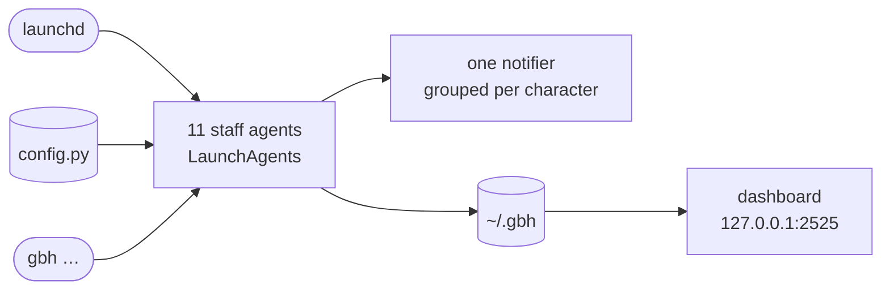

<p align="center">
  
</p>

<p align="center">
  <i>"There are still faint glimmers of civilization left in this barbaric slaughterhouse that was once known as humanity."</i><br>
  <sub>M. Gustave H.</sub>
</p>

<p align="center">
  <b>Eleven background agents that keep a Mac in order, each one a member of the hotel staff.</b><br>
  <sub>The Grand Budapest ran on precision and discretion, not because anyone was watching, but because that is how a great hotel is run. This suite works the same way: silently, in the background, and only heard from when something has gone wrong.</sub>
</p>

## Overview

A macOS automation suite told through the staff of the Grand Budapest Hotel. Eleven small background agents keep your Mac in order: sorting downloads, guarding ports, blocking distractions, clearing caches, noticing uncommitted work. You only hear from them when something has gone wrong.

> [!TIP]
> Nothing needs `sudo`. Even Ivan's focus mode blocks sites through a PAC proxy set with `networksetup`.

## Quick start

```bash
bash installer.sh
source ~/.zshrc
gbh                # the morning briefing
```

## How the hotel runs




<p align="center">
  <sub>
    <a href="#overview">OVERVIEW</a> &nbsp;·&nbsp;
    <a href="#quick-start">QUICK START</a> &nbsp;·&nbsp;
    <a href="#the-staff">THE STAFF</a> &nbsp;·&nbsp;
    <a href="#check-in">CHECK IN</a> &nbsp;·&nbsp;
    <a href="#at-your-service">AT YOUR SERVICE</a> &nbsp;·&nbsp;
    <a href="#the-front-desk">THE FRONT DESK</a>
  </sub>
</p>

<br>

## The staff

| | Who | Their job | On duty |
|---|---|---|---|
| 01 | **M. Gustave** | The concierge. A morning briefing: vitals, git, ports. | Login and every new terminal |
| 02 | **Serge X.** | The butler. Sorts everything dropped in Downloads and Desktop. | Always |
| 03 | **Dimitri** | Keeps watch over ports, logs and processes. | Always |
| 04 | **Zero** | The lobby boy. Sweeps old screenshots and duplicates. | Scheduled |
| 05 | **Ivan** | Makes the world go quiet. Focus mode that blocks distracting sites. | On demand |
| 06 | **Jopling** | Appears only when a process runs away with the CPU or memory. | Always |
| 07 | **Henckels** | Inspects the network and Wi-Fi. | Always |
| 08 | **Kovacs** | The lawyer. Uncommitted work does not go unnoticed. | Daily, 8 pm |
| 09 | **Clotilde** | Clears every cache overnight. | Daily, 3 am |
| 10 | **Ludwig** | A full inspection of the premises. | Sundays, 10 am |
| 11 | **Agatha** | Keeps the secrets: project archives and dotfile backups. | On demand |

## Check in

macOS, Homebrew and Python 3.11+.

```bash
bash installer.sh
source ~/.zshrc
```

Every agent is registered as a LaunchAgent and starts at once. Nothing needs `sudo`.

## At your service

```bash
gbh                        # Gustave's full briefing
gbh compact                # the one-line version, shown in every new terminal
```

<details>
<summary><b>Serge, the butler</b></summary>
<br>

Files dropped into `~/Downloads` or `~/Desktop` are moved into `Images/`, `Documents/`, `Audio/`, `Video/`, `Archives/` or `Others/`, and source files into `~/Documents/Projects/`. Every move is reversible.

```bash
gbh undo [n]               # put back the last n moves
```

</details>

<details>
<summary><b>Ivan, focus</b></summary>
<br>

```bash
gbh focus [minutes]        # block distracting sites, 25 minutes by default
gbh focus pause | resume | stop | status
gbh focus pomodoro [n]     # n cycles of 25 on, 5 off
```

Sites are blocked through a PAC proxy set with `networksetup`, which is why no `sudo` is needed. The list lives in `config.py` as `FOCUS_BLOCKLIST`.

</details>

<details>
<summary><b>Zero, Dimitri and Agatha</b></summary>
<br>

```bash
gbh clean                  # sweep old screenshots
gbh clean --old [days]     # archive old downloads
gbh clean --dupes [dir]    # find duplicates, interactively
gbh large [dir]            # files over 500 MB

gbh patrol                 # Dimitri's sentinel, normally started by launchd
gbh wait <port>            # notify when a port opens
gbh watch <file>           # watch a log for errors

gbh pack [path]            # zip a project, respecting .gbhignore
gbh backup                 # snapshot dotfiles to ~/.gbh/backups/
gbh restore [snapshot]
```

</details>

## The front desk

```bash
gbh open                   # http://127.0.0.1:2525
```

A live dashboard: CPU, memory, disk and battery, every staff member's status, Serge's move feed, and Ivan's focus controls, updated twice a second over a WebSocket.

Every notification is native, grouped per character in Notification Centre so they never pile up, with `terminal-notifier` as the fallback.

All settings (watched folders, destinations, blocked sites, critical ports, backed-up dotfiles, thresholds) live in one place, `config.py`.

<details>
<summary><b>Layout</b></summary>
<br>

```
main.py          the gbh command
server.py        the dashboard (FastAPI, port 2525)
config.py        every path, threshold and list
installer.sh     one-shot setup
staff/           one module per character, plus the shared notifier
```

</details>
